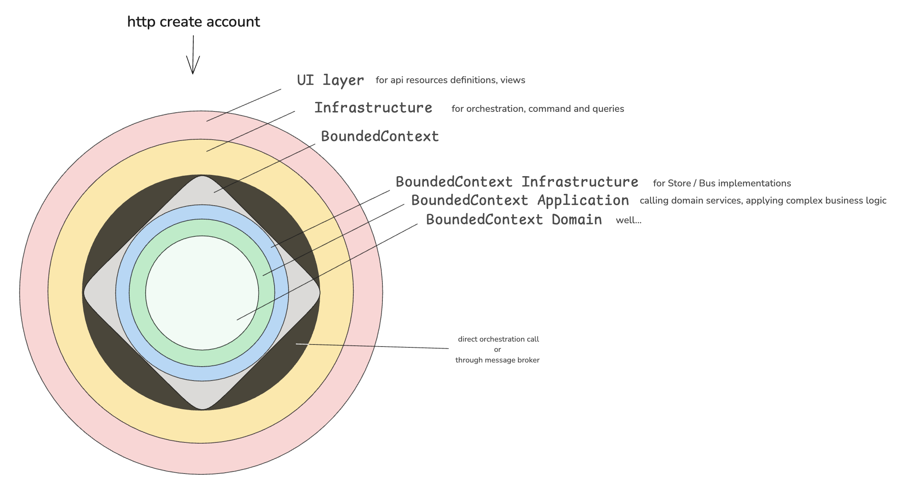
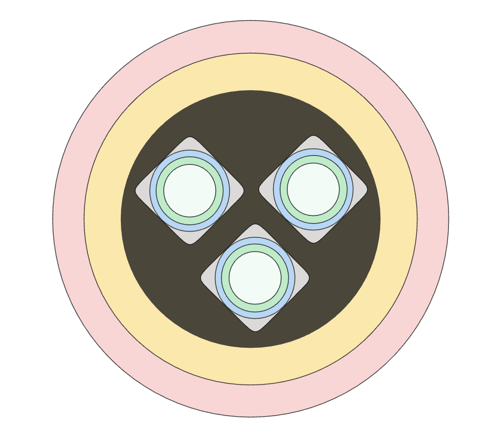

# Architectural Organization

To organize this project, the choice made is to adopt the clean architecture.

## Why?

I wanted a structure designed for modularity where the Domain would be the most isolated from the rest of the code.

There is the hexagonal architecture also known as port and adapter architecture that aims at creating loosely coupled application components that can be easily connected to the "outside world" (the database, for example) by means of ports and adapters. This makes components exchangeable at any level and facilitates test automation. 

The onion architecture is similar to the hexagonal architecture: it also externalizes the infrastructure with interfaces to ensure loose coupling between the application and the outside world. It decomposes further the application core into several concentric rings using inversion of control.

The clean architecture combines the principles of the hexagonal architecture, the onion architecture and several other variants. It provides additional levels of detail of the component, which are presented as concentric rings. It isolates adapters and interfaces (user interface, databases, external systems, devices) in the outer rings of the architecture and leaves the inner rings for use cases and entities. The clean architecture uses the principle of dependency inversion with the strict rule that dependencies shall only exist between an outer ring to an inner ring and never the contrary.

## How ?

I usually like to share "the missing chapter" of clean architecture, chapter 34.
It demonstrates how the responsibility can be "physically" dispatched in different blocs, with 6 variations. From these, 4 transport the same ideas. I will borrow the ideas this chapter introduces and push them a little more.

To give us this:

```
src/ 
├── UI/ (HTTP API controllers) 
│   ├── Api/ (Web Application handler, calls necessary CQS Commands and Queries)
│   │   ├── RPCProcessor/ (RPC commands)
│   │   ├── StateProcessor/ (ReST writers)
│   │   └── StateProvider/ (ReST readers)
│   │
│   ├── Console/ (CLI Application handler, calls necessary CQS Commands and Queries, maybe do some aggregations)
│   │   ├── Command/ (CLI writers)
│   │   └── Query/ (CLI readers)
│   │
│   ├── Web/ (Twig Application handler, one controller per page, calls the same CQS Commands and Queries)
│   │   ├── ContextA/ (one directory per bounded context)
│   │   └── ContextB/
│   │
│   └── Infrastructure/ (Libraries and framework code to support UI)
│       ├── ApiPlatform/ (Filters, Mappers, (De)Normalizers, Metadata, OpenAPI, Resources, RPC definitions, UriTransformer)
│       ├── Ecotone/ (Interceptors, Factories and Configurations)
│       ├── Symfony/ (Configuration, DI, Security, Validation, etc.)
│       └── OtherLib/ (Usually for config or extensions) 
│ 
├── Rental/ (Defines a rental)
│   ├── Application/ 
│   │   ├── Command/ (CQS commands with handlers)
│   │   ├── Event/ (CQS events with handlers)
│   │   ├── Query/ (CQS queries with handlers)
│   │   └── SomeComplexApplicationService/ (Usually under a directory to give it room to grow)
│   │
│   ├── Domain/ 
│   │   ├── Exception/ (Business errors)
│   │   ├── Model/ (Business classes, sometimes grouped under sub-directories)
│   │   ├── Repository/ (Repository interfaces)
│   │   └── SomeComplexDomainService/ (Usually under a directory to give it room to grow, e.g. an activation policy service)
│   │
│   └── Infrastructure/
│       ├── ApiPlatform/ (CQS commands with handlers)
│       ├── Ecotone/ (CQS events with handlers)
│       ├── Persistence/ (CQS queries with handlers)
│       ├── Symfony/ (CQS queries with handlers)
│       └── SomeComplexApplicationService/ (Usually under a directory to give it room to grow)
│
└── Restriction/ 
    ├── Settings/ (CTA/CTD, Min/MaxLoS...)
    │   ├── Application/ 
    │   ├── Domain/ 
    │   └── Infrastructure/
    │
    └── StopSell/ (Blocks certain types of reservations) 
        ├── Application/ 
        ├── Domain/ 
        └── Infrastructure/
```

To explain the structure, I need to rewind and reason around "communication" when we chose to use CQS.

### Communication from within.

In DDD with CQS, should there be two bounded contexts defined;
For a given command, is it ok to consider one bounded context to ask data from a second one? If yes, can we achieve this without technical shortcuts?

The short answer is: Yes, but.
Once a command is handled, one Bounded Context may need to interact with the data of another. Only if the data does not make any sense in the Domain we are in. **It should never be asked from a bounded context, the retrieve information and use it as if they were here**. Doing differently would create a very tight coupling.

So what should we do?

### Ways of communicating

We have **Domain Events and (a)synchronous communication**. We would have one bounded context publishing events when relevant data changes when an event is significant business wise, and other bounded contexts that would listen to these events to update their own **local data store**. 

Then we would have the **local data mechanism**. It is also a base principle in a CQS approach where we would **cache and maintain a local read model** with the necessary data synchronized from the other BC. We would have one bounded context publishing events when relevant data changes, and other bounded contexts that would listen to these events to update their own local data store. A mechanism that implies eventual consistency when asynchronous.

Or we could also **query another Bounded context through an API** of some sort. The Open Host Service approach from the DDD "blue book". We would place the calls in the **Application Layer or UI Layer**, depending on the specific use case. Of course, it's not the domain responsibility to depend on external services, it would violate the separation of concerns. And it is also not the responsibility of the client to do so, keeping encapsulation and business logic centralization intact. Receiving these external context data, would sometimes end up in saving data in their own **local data store**.

"Wait, wait, wait. Aren't these two first paragraph the same thing?"
Yes.

**The only difference lies within the intention.**  
First time I meant it as a chain reaction of business event, a business workflow. "When an order is created, we need to create an invoice, and create an accounting record...".  
The second time, I meant it as sending data for replication and fast decoupled read, or data reinforcement.

Now there are ways to do it that we want to avoid. Direct access to the database queries that create a very strong coupling with the shape of the data, synchronous call through a bus that would reduce availability. Or call the other BC services directly when the BC are in the same project.

But! If the other context is in the same project, then there are fair questions. Isn't it too much to query the data with HTTP? Would it be wrong for a bounded context to hold the UI layer, and then we just talk directly to the neighbor? let's answer these questions.

## Would it be wrong for a bounded context to hold the UI layer?

It’s not wrong. Although, it depends on the scope and isolation level you want for your Bounded Context. If you were to build a microservice, it would make sense.

```
UserManagementContext 
│ 
├── Application 
├── Domain 
├── Infrastructure 
└── UI
```

We have this nice vertical distribution, and since nothing else but this autonomeous module exists, having this UI/Api layer mixed in is fine. Now, you want to add another autonomeous module with its own UI? Go for it. Although, I would add that this microservice must ideally be responsible to express their routing acceptances either for themselves or in behalf of the Ingress. If you have to additionnally write them in your Ingress directly (it would be a kubernetes ingress, a simple reverse-proxy...), then It has nothing to do here. It is just an extra layer for a job that has already been made.

But if your project should have a unified UI layer (a single frontend, or a single API for multiple contexts), having the declaration inside each context will most probably lead to a scattered API definition. Yes, we can mitigate this effect with design systems, storybook, stoplight spectral tool, etc. and mostly with great coordination. But not every team has the same budget, time and people to have this. And again, the UI Layer doesn’t know or care about “User Management” or “Billing.” It just expresses intentions. 

Of course, with the help of your preferred framework, what if the first few contexts designed are built within the same source code? It could be easier. Now have a look at the code you wrote in the past. How close are you to the code you write today? Of course, it is better now. The same will happen to your UI and Apis, and it will hurt the predictability. Even more so for graphical UI.

So to reach a higher consistency, I would recommend to have the UI at the same level I declare the different contexts.

```
src/ 
├── UI/ 
│   ├── Api/
│   ├── Console/
│   ├── Web/
│   └── Infrastructure/
│
├── UserManagement/ 
│   ├── Application/ 
│   ├── Domain/ 
│   └── Infrastructure/ 
│ 
└── Orders/ 
    ├── Application/ 
    ├── Domain/ 
    └── Infrastructure/
```

Which could be illustrated  



And if we need to split the Contexts into modules for clarity, we can do it as follows:

```
src/ 
├── UI/ (HTTP API controllers) 
│   ├── Api/
│   │   ├── ContextA/ModuleA/ 
│   │   └── ContextA/ModuleB/
│   ├── Console/
│   │   ├── ContextA/ModuleA/ 
│   │   └── ContextA/ModuleB/
│   ├── Web/
│   │   ├── ContextA/ModuleA/ 
│   │   └── ContextA/ModuleB/
│   └── Infrastructure/ 
│       ├── ContextA/ModuleA/ 
│       └── ContextA/ModuleB/
└── ContextA/ 
    ├── ModuleA/ 
    └── ModuleB/ 
```

And because we never deal with just one Bounded Context, I would actually represent the shape of that architecture like this.



## Where does a page live?

I wrote everything above with two ways in, an HTTP API and a terminal, and the tree stops at `Api/`,
`Console/` and `Infrastructure/` because at the time those were the only two. That was never a
decision to have no others; it is a document written before the third one existed. The third one
exists now, and this section decides where it goes.

It is worth saying plainly what pushed it, and what did not. Twenty five of the thirty six cards on
the board name Twig among their deliveries and twenty seven mention a page, a
template or a controller somewhere in their text, all of them writing
`Ui/Web/<Context>/<Name>Controller` and `templates/<context>/` as if somebody had decided it.
[ADR 008](008_security.md) already counts four deliveries and gives the Twig one its own row, a
session and a `Session` authority. The Odd Badge design system, which is the product's visual
language, builds on the same convention and says out loud that it is downstream of these documents:
when a page there disagrees with an ADR, the ADR is right and the page is the bug. **So the design
system is what made me notice this decision was missing; it is not what took it.** A convention that
much work is about to rest on, taken by nobody and written down nowhere, is a decision by default,
and a decision by default is the thing this directory exists to prevent.

The diagrams above spell the directory `UI/`; on disk and in every namespace it is `Ui/`, and I
write it that way from here on.

### A page is a delivery, so it lives where the deliveries live

**`Ui/Web/` is where a Twig delivery lives**, beside `Ui/Api/` and `Ui/Console/`, and never inside a
bounded context.

I wrote this section with a per-context controller under it, `Ui/Web/<Context>/<Name>Controller.php`,
and [ADR 009](009_one-url-two-representations.md) narrowed it the same week. A page that renders a
resource has no controller at all: it is a second representation of an address API Platform already
owns, chosen by `Accept`, and it is a template and nothing else. What is left here is real but
small: the login form, the logout route, and an asset that is a pure function of its path. Read
ADR 009 before adding anything under `Ui/Web/`, because the shape below is the part it kept and the
directory layout is the part it took.

I do not need a new argument for this, because it is the argument I already made one level up,
applied one level down. I hoisted `Ui` out of the contexts so the delivery surface would stay
consistent across them, and the same reasoning decides the same way here: a reader who asks "how
does this application answer a browser" should open one directory and read it, rather than visit
four contexts and reconcile what they find. I even wrote above that scattering hurts a graphical UI
more than an API, and then left the graphical UI without a home of its own.

There is no `Ui/Web/<Context>/` level. The `ContextA/ModuleA` split the tree above shows under each
delivery is there for a delivery with enough classes to need sorting, and this one has three; the
context level would be a directory per file. `Ui/Api/` earns it and `Ui/Web/` does not, which is the
first time in this document that two deliveries have not taken the same shape, and it is worth
noticing rather than smoothing over.

### Twig is a vendor a delivery may name

**`Twig` joins `ArchitectureTestCase::vendors()`, alongside `ApiPlatform`, `Doctrine`, `Ecotone`,
`Psr` and `Symfony`.**

This one came out of the code rather than out of a document, which is the direction this repository
says it does not work in, so it is worth writing down what happened. `BadgeRenderer` is presentation
by the rule below and its Twig extension sits in `Ui/Web/Rendering/`, which is correct;
`phpat` then failed it, because `Twig` was in none of the allow-lists and a Twig delivery cannot
exist without naming Twig somewhere.

`Firebase` joined the same list shortly afterwards, for the JWT library ADR 009 rule 9's revocable
token needs, and it is here on this paragraph's criterion rather than on a new one. I am naming it
so that the list does not quietly grow: **a vendor goes in `vendors()` when misusing it would be
merely odd, and gets a narrowing rule of its own only when misusing it would be a bug that
compiles.** Two entries now rest on that sentence, which is one more than it had when I wrote it.

`Firebase` has since become `Lexik`, because `AccessTokens` swapped `firebase/php-jwt` for
`lexik/jwt-authentication-bundle`'s encoder. The entry moved and the criterion did not: that is the
first evidence I have that the sentence above is doing work, since a list with a line per vendor
would have grown by one and kept a dead entry, and this one was a rename. The swap is also the first
time the criterion has had to cover a **bundle** rather than a library, which is wider than it was:
the namespace now contains a firewall authenticator and a user provider that `security.php`
deliberately does not use, and `phpat` cannot tell an unused half of a vendor from a used one. I am
leaving it in `vendors()` rather than narrowing it, on the same test: naming Lexik's authenticator
from a context would be visible at the type and at a review, not a null in a worker. The cost is
recorded in `ArchitectureTestCase`'s docblock so that the next person weighing a narrowing finds the
argument instead of guessing at it.

The narrower fix was available and I did not take it: allow `Twig` only under `App\Ui`, the shape
[ADR 007](007_translation.md)'s `no_translator_outside_ui` and [ADR 008](008_security.md)'s
`no_security_outside_ui` both use. Those two rules exist because naming their component outside a
delivery is a *bug*: `Security::getUser()` returns null in the worker, and a translated string
produced in a Domain has no reader. Twig has no such failure mode. A context's infrastructure with
a `use Twig\...` in it would be strange, and strange is what a code review is for; it is not the
kind of wrong that compiles, passes in a request and breaks on the console. A rule set stops meaning
anything if it collects every preference alongside the three things that genuinely bite.

### Templates are not source

**A template is not source, so it does not live under `src/`.** A page's template is
`templates/<context>/<page>.html.twig`, and a partial more than one page shares is
`templates/components/_<component>.html.twig`.

Twig's loader is rooted at `templates/`, and a `.html.twig` is found by a path rather than by a
class name, so no autoloader and no PSR-4 rule ever looks at it. Mirroring the PHP tree under `src/`
would buy a symmetry and pay for it with a loader path to configure, a second convention to learn
and an invitation to put a `.php` file next to a `.twig` one. The single thing that does mirror is
the context directory, and it mirrors the controller's namespace on purpose: a reader holding
`Ui/Web/Membership/ShowBadgeCollectionController` knows where its template is without being told.

### `Ui/Web` may name a context's `Application`, and may not name its `Infrastructure`

**A controller reaches a context through a bus, and through nothing else.**

This is the permission `Ui/Api` already has, for the reason `UiArchitectureTest` gives in its
docblock: expressing an intention means putting a command object on a bus, so `Ui` has to be able to
name the command. Reading is the same journey through the query bus to a port in the context's
`Application/ReadModel/`, per [ADR 004](004_filter.md). The prohibition carries over unchanged: a
controller allowed to name `App\Membership\Infrastructure` could hold a repository implementation, a
gateway or a connection, and then the layering is decoration.

I am writing it here so the architecture rule that enforces it encodes a decision instead of
inventing one. A rule with no ADR behind it is somebody's preference with a test around it.

### A delivery may compute presentation, and nothing else

**Presentation is a pure function of what the page already holds; the moment a computation needs a
store, a clock or an aggregate, it is not presentation and it is not the delivery's to do.**

The worked example is the drawn badge. A `BadgeDesign` is a `Color` and a `Motif`
(`Membership/Domain/ValueObject/`), five cases each and both closed, so the picture of a badge is a
pure function of that pair and a size: no query, no aggregate, nothing that can go stale. That is
presentation by the rule above, so it belongs to the delivery's own infrastructure,
`Ui/Web/Rendering/BadgeRenderer`, and **it takes a `BadgeDesign` rather than two strings**.
That last part is [ADR 005](005_validation.md)'s permission for an edge, used exactly as ADR 005
means it: the edge calls the domain's type, it does not restate what the type means. Two strings in
that signature would be a second and silent copy of which colours and which motifs exist.

The counter-example deserves writing down, because it is the tempting one and somebody will propose
it: the badge must not become a base64 field on `GET /members/{memberId}`. Put it there and every
list response carries an image forever, the API owns a rendering decision it cannot revise without
a breaking change, and the console pays for a picture it will never print. A representation says
what something is; what it looks like is a question each delivery gets to answer for itself.

### What this section deliberately does not decide

- **nothing about `symfony/form`.** [ADR 004](004_filter.md)'s option B promises three delivery
  surfaces from one declaration and only two of them exist; the third is form fields, and
  `membership/06` is its first user. That is a gap I
  can name here, not a shape I should guess at;
- **nothing about authentication.** The session, the login form and CSRF belong to
  [ADR 008](008_security.md) and to `platform/01`. This
  section has to be readable by somebody who has read neither, and it is: where a page lives does
  not depend on how its reader signed in.

A last note for whoever cites this later. This document predates the house structure the other ADRs
use, so it carries no numbered "rules this obeys" list for me to append to, and this section does
not start one. Cite it by its headings.

## The tree moved underneath this document, and this is the note saying so

The reference tree near the top of this ADR shows `UI/Infrastructure/`, with `ApiPlatform/`,
`Ecotone/`, `Symfony/` and `OtherLib/` under it. **That directory no longer exists.** Everything
that was in it is now under `src/Shared/Infrastructure/`, and the classes that extend a library
carry that library's own namespace instead of `App\`:

| was                                            | is                                                        |
|------------------------------------------------|-----------------------------------------------------------|
| `App\Ui\Infrastructure\ApiPlatform\JsonRpc\*`     | `ApiPlatform\JsonRpc\*`                                   |
| `App\Ui\Infrastructure\ApiPlatform\Metadata\*`    | `ApiPlatform\Metadata\*`                                  |
| `App\Ui\Infrastructure\ApiPlatform\OpenApi\*`     | `ApiPlatform\OpenApi\*`                                   |
| `App\Ui\Infrastructure\ApiPlatform\State\*`       | `ApiPlatform\State\*`                                     |
| `App\Ui\Infrastructure\Security\*`                | `App\Shared\Infrastructure\Security\*`                   |
| `App\Ui\Infrastructure\Translation\FailureMessages`| `Translation\FailureMessages`                             |
| `App\Ui\Infrastructure\ApiPlatform\Resources\*`   | `App\Ui\Api\Resources\*`                                 |

**I did not make this move and I am not going to argue it here on its author's behalf.** What this
section does is record that the document and the tree disagree, and name the three things the move
costs, so that whoever writes the argument has the bill in front of them:

1. **`Shared` now names a bounded context.** `App\Shared\Infrastructure\Security\Actor`,
   `Credential`, `Ownership` and four others import `App\Membership\Domain\Model\Member`, six of
   them only as the phantom tag on an `Id<Member>` ([ADR 002](002_identifying-everything.md)) and
   `Ownership` as a real dependency on `MemberNotFoundException`. `Shared` may never depend on a
   context; that is the oldest rule in this document and `SharedArchitectureTest` enforces it. It
   now reports sixteen violations, and they are true. Either the security vocabulary is not
   `Shared`, or `Shared` means something else than it did.
2. **`no_security_outside_ui` lost its edge.** [ADR 008](008_security.md) narrowed the rule set so
   that `Symfony\Component\Security` could be named under `App\Ui` and nowhere else, because the
   bug it exists to catch (`Security::getUser()` autowired into a context's service, which works in
   a request and returns null in a worker) compiles. With the vocabulary in `Shared`, the rule
   carries an exclusion for the one namespace that is the adapter. It still catches the bug; it no
   longer reads as a guarantee.
3. **the namespaces are not ours.** A class in `ApiPlatform\Metadata\` is in a namespace API
   Platform owns and may add to. The collision would be silent until a release ships a class of the
   same name, and the two PSR-4 roots that make this resolve at all are in `composer.json` rather
   than in anything a reader of `src/` can see.

None of those three is fatal and the first is the interesting one, because it is the question this
ADR opened with ("would it be wrong for a bounded context to hold the UI layer?") asked from the
other side: what is `Shared` for, if a delivery's vocabulary lives in it?
